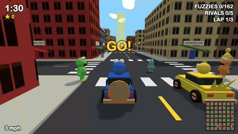

# Cookie Collisions

A 3D car combat game in the browser: Carmageddon rules on a street full of fuzzy puppet-ish neighbours. Today's carnage is brought to you by the letter C and the number 88 mph.



## Play

There is no build step. Serve the folder and open it (Three.js loads from a CDN, so you need to be online):

```bash
python3 -m http.server 8123
```

Then visit http://localhost:8123.

## How to win

Pick one of six drivers, then win any way you like before the clock runs out:

- finish 3 laps through the checkpoints
- wreck every rival
- flatten every fuzzy on the map

Splats, checkpoints and ramming rivals all add time. Alphabet blocks give power-ups (and one bad one), cookies give points and small repairs.

## Controls

| Key | Action |
|---|---|
| W A S D / arrows | Drive |
| Space | Handbrake |
| H | Horn |
| R | Repair (300 points) |
| C | Camera |
| M | Mute |
| P | Pause |

## Code

- `src/main.js`: game loop, physics, AI, rules and HUD
- `src/world.js`: the city and its street furniture
- `src/characters.js`: drivers, pedestrians and cars, all built from primitives
- `src/audio.js`: synthesized sound and music

This is an unofficial parody and is not affiliated with any children's television programme.
